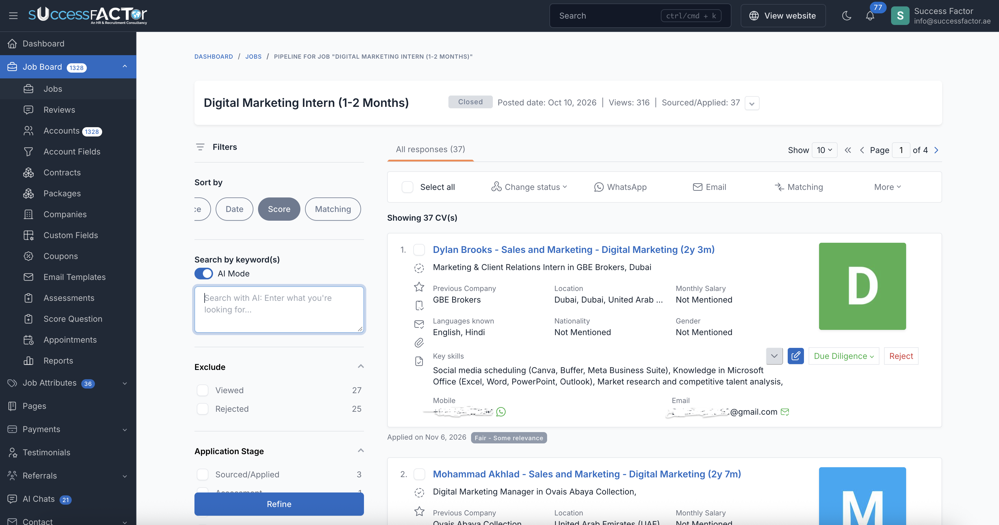

::: {align="center"}
# Waseem Ibrar

### Full-Stack Engineer · AI Automation · DevOps & Cloud

Building scalable web applications, intelligent business workflows, and
reliable production infrastructure.

[](https://github.com/waseemibrar)
[](https://linkedin.com/in/waseem-ibrar)
[](mailto:w4waseemibrar@gmail.com)
[](https://www.fiverr.com/waseem_ibrar)

📍 Dubai, UAE · 7+ years of experience
:::

------------------------------------------------------------------------

## About

I'm a **Full-Stack & AI Automation Engineer** with 7+ years of
experience delivering enterprise applications, AI-powered automation,
business integrations, and cloud infrastructure.

I work across the full delivery lifecycle --- from solution design and
development to deployment, automation, and production support. I enjoy
connecting systems and turning repetitive business processes into
dependable workflows.

-   **Currently:** Full-Stack & AI Automation Engineer at Success Factor
-   **Focus:** AI-enabled workflows, enterprise integrations, scalable
    applications, and DevOps
-   **Strengths:** Laravel, Vue, TypeScript, APIs, Linux, and production
    infrastructure

## Featured work

> Replace each preview image with a real project screenshot when ready.
> See **Adding project screenshots** below.

```{=html}
<table>
```
```{=html}
<tr>
```
```{=html}
<td width="50%" valign="top">
```
`<a href="https://successfactor.ae">`{=html}
``{=html}
`</a>`{=html}
```{=html}
<h3>
```
AI Recruitment Automation Platform
```{=html}
</h3>
```
Automated candidate intake, screening, assessments, application
tracking, interview scheduling, and communications.
`<br>`{=html}`<br>`{=html} `<sub>`{=html}`<b>`{=html}Stack:`</b>`{=html}
Laravel · Vue · TypeScript · Vector DB · Messaging APIs`</sub>`{=html}
```{=html}
</td>
```
```{=html}
<td width="50%" valign="top">
```
``{=html}
```{=html}
<h3>
```
WhatsApp Business Automation
```{=html}
</h3>
```
AI-driven customer engagement and support workflows integrating business
messaging platforms. `<br>`{=html}`<br>`{=html}
`<sub>`{=html}`<b>`{=html}Stack:`</b>`{=html} WhatsApp Cloud API ·
Twilio · MessageBird · Webhooks`</sub>`{=html}
```{=html}
</td>
```
```{=html}
</tr>
```
```{=html}
<tr>
```
```{=html}
<td width="50%" valign="top">
```
``{=html}
```{=html}
<h3>
```
ERP & CRM Integrations
```{=html}
</h3>
```
Connected business systems and automated operational and CRM data
synchronization. `<br>`{=html}`<br>`{=html}
`<sub>`{=html}`<b>`{=html}Stack:`</b>`{=html} Odoo · Zoho CRM ·
Microsoft 365 · Google APIs`</sub>`{=html}
```{=html}
</td>
```
```{=html}
<td width="50%" valign="top">
```
``{=html}
```{=html}
<h3>
```
Infrastructure & Deployment Automation
```{=html}
</h3>
```
Managed Linux/VPS environments, web servers, SSL, DNS, scheduled jobs,
process supervision, and CI/CD. `<br>`{=html}`<br>`{=html}
`<sub>`{=html}`<b>`{=html}Stack:`</b>`{=html} Linux · AWS · Nginx ·
Apache · GitHub Actions · Shell`</sub>`{=html}
```{=html}
</td>
```
```{=html}
</tr>
```
```{=html}
</table>
```
## Tech stack

**Languages & frameworks**


**Data, cloud & DevOps**


**Automation & business platforms**


## Experience

  -----------------------------------------------------------------------
  Role                    Organization            Period
  ----------------------- ----------------------- -----------------------
  Full-Stack & AI         Success Factor · Dubai  Sep 2024 -- Present
  Automation Engineer                             

  Full-Stack Developer    Happy Helpers · Dubai   2022 -- Sep 2024

  Lead Web Developer      Enovtec · Islamabad     2020 -- 2022

  Web Developer Intern &  Khattak Computer        2018 -- 2020
  Junior                  Academy · Karak         
  -----------------------------------------------------------------------

## GitHub activity

::: {align="center"}
``{=html}
``{=html}
:::

::: {align="center"}
``{=html}
:::

## Education

**Bachelor of Computer Science (BCS)**\
Khushal Khan Khattak University, Karak, Pakistan · 2019

## Let's connect

Have a project involving full-stack development, AI automation,
integrations, or infrastructure?

-   **Email:** <w4waseemibrar@gmail.com>
-   **LinkedIn:**
    [linkedin.com/in/waseem-ibrar](https://linkedin.com/in/waseem-ibrar)
-   **Upwork:** [Hire me on
    Upwork](https://www.upwork.com/freelancers/~019a607a7fd659202e)
-   **Fiverr:** [Hire me on Fiverr](https://www.fiverr.com/waseem_ibrar)
-   **Website:** [successfactor.ae](https://successfactor.ae)

------------------------------------------------------------------------

::: {align="center"}
`<sub>`{=html}Designed with care · Built with curiosity · Always
learning`</sub>`{=html}
:::

```{=html}
<!--
ADDING PROJECT SCREENSHOTS
1. In your profile repository, create: assets/projects/
2. Upload screenshots with these filenames:
   - ai-recruitment.png
   - whatsapp-automation.png
   - erp-crm-integrations.png
   - infrastructure-automation.png
3. Replace each placehold.co image URL above with its repository path, for example:
   
4. Use clear, cropped screenshots (ideally 1200 × 650 px). Hide private data, API keys,
   customer names, email addresses, and other confidential information before uploading.

PUBLISHING
1. Create a public GitHub repository named exactly: waseemibrar
2. Make sure the repository owner username is waseemibrar.
3. Add this file as README.md in the repository root and commit it.
4. Your profile README will appear at https://github.com/waseemibrar.
-->
```
